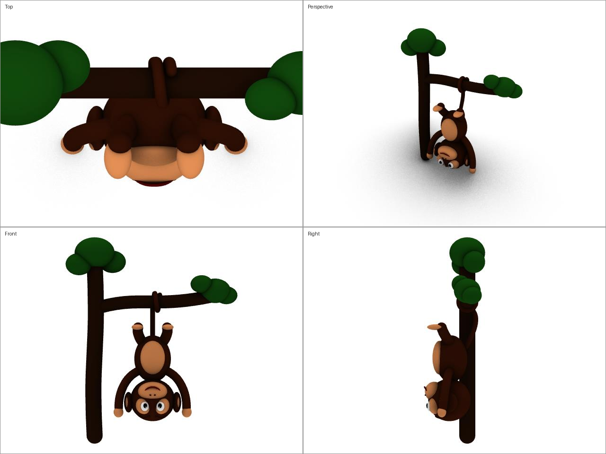
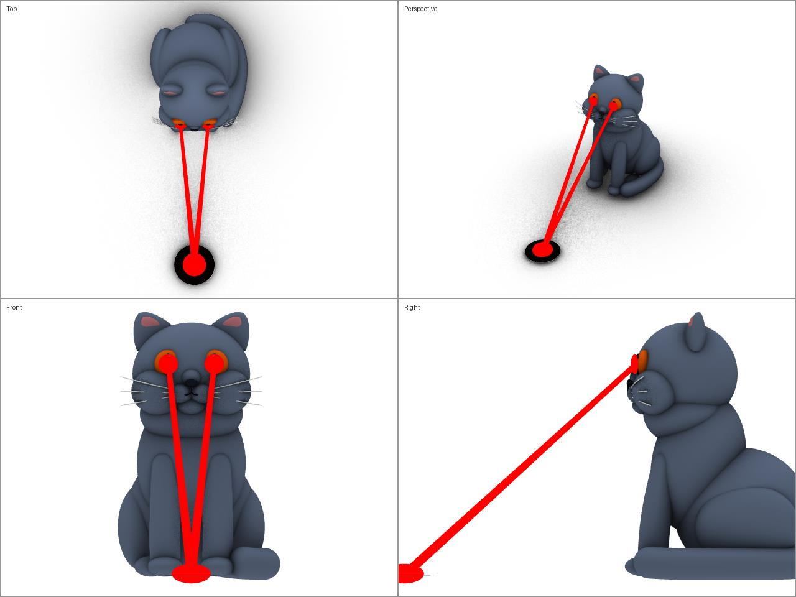

# rhino3d_ws

Rhino3D MCP로 3D 모델링을 연습하는 저장소입니다. Claude Code가 Rhino 9의 MCP 서버에 연결해 Python 스크립트로 모델을 만들고, 렌더 이미지로 결과를 확인합니다.

| monkey v003 | cat v002 |
|---|---|
|  |  |

## 프로젝트

### monkey: 만화풍 원숭이
- **v001**: 처음 만든 원숭이. 머리, 눈, 주둥이, 귀, 몸통, 팔다리, 말린 꼬리.
- **v002**: 눈썹을 좌우로 나뉜 얇은 아치형으로 바꿈.
- **v003**: 꼬리로 나뭇가지에 거꾸로 매달린 자세. 나무도 추가함.

### cat: 앉아 있는 브리티쉬 숏헤어
- **v001**: 블루그레이 털, 구리색 큰 눈, 통통한 볼, 짧고 굵은 꼬리.
- **v002**: 눈에서 레이저 발사. 빔이 바닥의 한 점에서 만나고, 그 자리에 그을린 자국이 남음.
- **Grasshopper 리그** (`cat/cat_rig_v003.gh`): 슬라이더로 고양이를 움직입니다.
  - 머리(좌우로 돌리기·끄덕이기·갸웃하기), 귀, 동공 크기, 앞발, 꼬리, 숨쉬기, 수염
  - 꼬리 흔들기 애니메이션: 실시간으로 재생하거나, 원하는 시점에서 멈춰 볼 수 있음
  - 레이저: 머리 방향을 따라가며 바닥과 만나는 점을 다시 계산함

각 프로젝트의 자세한 상태와 버전 내역은 `<project>/handoff.md`에 있습니다.

## 환경

- **Rhino PC (Windows)**: Rhino 9 + MCP 서버
  - Rhino의 MCP 서버(`127.0.0.1:10500`)는 localhost 요청만 받습니다. 그래서 `tools/rhino3d_mcp_proxy.py`가 `0.0.0.0:10501`에서 받은 요청의 Host 헤더를 바꿔 Rhino로 넘깁니다.
  - 프로젝트 폴더는 `D:\rhino3d_ws`입니다.
- **Linux PC**: Claude Code
  - 같은 폴더를 CIFS로 마운트해서 씁니다.
  - MCP 서버 주소는 `http://norang.lan:10501/`이고, Claude Code에는 `rhino`라는 이름으로 등록되어 있습니다.

## 폴더 구조

```
rhino3d_ws/
  CLAUDE.md          # Claude Code 작업 규칙
  tools/             # 공용 도구
  <project>/
    handoff.md       # 프로젝트 상태와 버전 내역
    <project>_vNNN.3dm / .py / .jpg / .png
```

- 모델 버전은 파일명(`_v001`, `_v002`, …)으로 관리하고, 기존 버전은 덮어쓰지 않습니다.
- `.py`는 그 버전을 만든 Rhino 스크립트이고, `.jpg`·`.png`는 미리보기 이미지입니다.
- STL 파일은 용량이 커서 저장소에 넣지 않았습니다(`.gitignore`). `.3dm`에서 다시 만들 수 있습니다.

## 도구 (`tools/`)

| 파일 | 실행 위치 | 하는 일 |
|---|---|---|
| `rmcp.py` | Linux | MCP 도구 호출, Rhino에서 스크립트 실행, 캡처, 다음 버전으로 저장, 4면 미리보기, STL 내보내기 |
| `rhino_remote.py` | Linux | SSH로 Rhino PC에서 Rhino와 MCP를 켜고 끄고, 상태를 확인 |
| `stl2img.py` | Linux | STL을 PNG로 렌더 (f3d 사용) |
| `rhino3d_mcpstart.bat` | Rhino PC | 방화벽 규칙을 열고, Rhino를 MCPStart로 실행하고, 프록시를 시작 |
| `rhino3d_mcpstop.bat` | Rhino PC | 프록시를 멈추고, 방화벽 규칙을 지우고, Rhino를 종료 |
| `rhino3d_mcp_proxy.py` | Rhino PC | 외부 요청의 Host 헤더를 바꿔 Rhino MCP로 넘기는 프록시 |

자주 쓰는 명령:

```sh
python3 tools/rhino_remote.py start                  # Rhino PC에서 Rhino와 MCP 시작
python3 tools/rmcp.py call get_context '{}'          # Rhino 문서 상태 확인
python3 tools/rmcp.py run cat/cat_v002.py            # 스크립트로 모델 만들기
python3 tools/rmcp.py save cat cat/cat_v002.py       # 다음 버전으로 저장 (.3dm/.jpg/.py)
python3 tools/rmcp.py preview cat                    # 4면 미리보기 PNG
```
